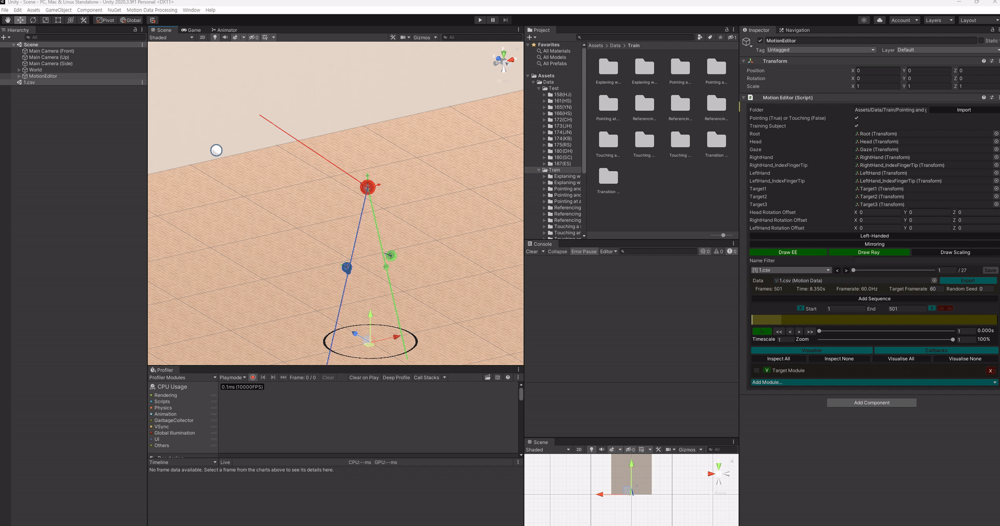

# Part-wise Translation of Upper-body Gestures via Real-time Target Estimation for Virtual Avatars in Dissimilar Environments (Official Implementation)
    

> **Part-wise Translation of Upper-body Gestures via Real-time Target Estimation for Virtual Avatars in Dissimilar Environments** 
> Jiho Kang, Jihun Shin, Kwang Bin Lee, Dong Hwan Shin, Yuna Choi, and [Sung-Hee Lee](https://scholar.google.com/citations?hl=en&user=AVII4wsAAAAJ) 
> IEEE TVCG, Under Review

## Checklist

### Unity
- [x] Data import
- [x] Data processing (e.g., target labeling)
- [x] Data visualization
- [x] Data export (for training/evaluation)
- [ ] Real-time inference

### DeepLearning
- [x] Model (TENet, BP_GTNet)
- [x] Training
- [ ] Evaluation
- [x] Real-time inference

## Data

Download the data from Google Drive and unzip each archive to the specified location:

| Data | Description | Location |
| --- | --- | --- |
| [Motion Capture Data](https://drive.google.com/file/d/1EzcetggbN8AMRDQDppRYPFkCk7DHdYQO/view?usp=sharing) | Raw motion capture data | `Unity/` |
| [Target Labeled Data](https://drive.google.com/file/d/1qqO5hcnfvh7bA3q22fnZ2oR4pdn2oCWR/view?usp=sharing) | Target-labeled motion capture data | `Unity/Assets/Data/` |

## Data Import

Before getting started, please refer to the GIF below.

> **Note:** If you simply place the *Target Labeled Data* into `Unity/Assets/Data/`, you can skip this step. This import process is intended for cases where you need to import the *raw motion capture data* — for example, to label targets yourself or to annotate additional features.

1\) Open the data scene (`Unity/Assets/Data/Scene.unity`). 
2\) From the top menu bar, open **Motion Data Processing → Motion Importer**. 
3\) In the **Motion Importer** window, select the split (**Train** / **Test**) and choose which data to import. 
4\) Click **Import Motion**. 
5\) Verify that the data has been correctly added under `Unity/Assets/Data/`.

## Data Visualization

In `Unity/Assets/Data/Scene.unity`, select the **MotionEditor** GameObject to play back the motion capture data and inspect the target-labeling information through its attached script.

The table below illustrates the visualization:

- ⚪ **White spheres** are the target candidates.
- When a candidate is labeled as a target, a colored sphere is rendered on top of it: 🔴 **red** for the head target, 🟢 **green** for the right-hand target, and 🔵 **blue** for the left-hand target.
- The head, right-hand, and left-hand **end-effectors** are rendered as red, green, and blue spheres, each with a transformation gizmo.
- The red, green, and blue **rays** denote the gaze, the eye-finger ray (right hand), and the eye-finger ray (left hand), respectively.

<table>
<tr>
<td></td>
<td></td>
</tr>
<tr>
<td><b>Explaining with pointing</b></td>
<td><b>Touching and gazing at two targets in sequence</b></td>
</tr>
<tr>
<td></td>
<td></td>
</tr>
<tr>
<td><b>Referencing multiple targets with diverse gestures (referential, beat, descriptive gestures)</b></td>
<td><b>Referencing multiple targets with diverse gestures (dynamic pointing gesture, touching gesture)</b></td>
</tr>
<tr>
<td></td>
<td></td>
</tr>
<tr>
<td><b>Referencing multiple targets with diverse gestures (descriptive, referential, dynamic pointing gestures)</b></td>
<td><b>Touching a single target with gaze shift</b></td>
</tr>
</table>

## Data Export

_Coming soon._

## Acknowledgements

This repository contains pieces of code from the following repositories:
- [AI4Animation: Deep Learning for Character Control](https://github.com/sebastianstarke/AI4Animation/tree/master)
