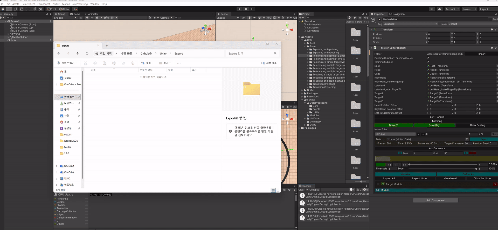

# Part-wise Translation of Upper-body Gestures via Real-time Target Estimation for Virtual Avatars in Dissimilar Environments (Official Implementation)
    

> **Part-wise Translation of Upper-body Gestures via Real-time Target Estimation for Virtual Avatars in Dissimilar Environments**<br>
> Jiho Kang, Jihun Shin, Kwang Bin Lee, Dong Hwan Shin, Yuna Choi, and [Sung-Hee Lee](https://scholar.google.com/citations?hl=en&user=AVII4wsAAAAJ)<br>
> IEEE TVCG, Under Review

## Checklist

### Unity
- [x] Data import
- [x] Data processing (e.g., target labeling)
- [x] Data visualization
- [x] Data export (for training/evaluation)
- [x] Real-time inference

### DeepLearning
- [x] Model (TENet, BP-GTNet)
- [x] Training
- [x] Evaluation
- [x] Real-time inference

## Data

Download the data from Google Drive and unzip each archive to the specified location:

| Data | Description | Location |
| --- | --- | --- |
| [Motion Capture Data](https://drive.google.com/file/d/1EzcetggbN8AMRDQDppRYPFkCk7DHdYQO/view?usp=sharing) | Raw motion capture data | `Unity/` |
| [Target Labeled Data](https://drive.google.com/file/d/1qqO5hcnfvh7bA3q22fnZ2oR4pdn2oCWR/view?usp=sharing) | Target-labeled motion capture data | `Unity/Assets/Data/` |
| [Evaluation Data](TODO_GOOGLE_DRIVE_LINK) | Exported test sets of TENet, BP-GTNet (and its w/o EE-Dual ablation) and the UGNet baseline | `DeepLearning/data(raw)/` |
| [Estimated Targets](TODO_GOOGLE_DRIVE_LINK) | Targets estimated by TENet and the sampled avatar targets used in Table IV (`Estimated Targets(3)`, `(5)`, `(7)`) | `DeepLearning/` |

## Data Import

This step imports the raw motion capture data into Unity so that it can be processed and inspected.

Before getting started, please refer to the GIF below.

> **Note:** If you simply place the *Target Labeled Data* into `Unity/Assets/Data/`, you can skip this step. This import process is intended for cases where you need to import the *raw motion capture data* — for example, to label targets yourself or to annotate additional features.


1\) Open the data scene (`Unity/Assets/Data/Scene.unity`).<br>
2\) From the top menu bar, open **Motion Data Processing → Motion Importer**.<br>
3\) In the **Motion Importer** window, select the split (**Train**/**Test**) and choose which data to import.<br>
4\) Click **Import Motion**.<br>
5\) Verify that the data has been correctly added under `Unity/Assets/Data/`.

## Data Visualization

In `Unity/Assets/Data/Scene.unity`, select the **MotionEditor** GameObject to play back the motion capture data and inspect the target-labeling information through its attached script.

The table below illustrates the visualization:

- ⚪ **White spheres** are the target candidates.
- When a candidate is labeled as a target, a colored sphere is rendered on top of it: 🔴 **red** for the head target, 🟢 **green** for the right-hand target, and 🔵 **blue** for the left-hand target.
- The head, right-hand, and left-hand **end-effectors** are rendered as red, green, and blue spheres, each with a transformation gizmo.
- The red, green, and blue **rays** denote the gaze, the eye-finger ray (right hand), and the eye-finger ray (left hand), respectively.

<table>
<tr>
<td></td>
<td></td>
</tr>
<tr>
<td><b>Explaining with pointing</b></td>
<td><b>Touching and gazing at two targets in sequence</b></td>
</tr>
<tr>
<td></td>
<td></td>
</tr>
<tr>
<td><b>Referencing multiple targets with diverse gestures (referential, beat, descriptive gestures)</b></td>
<td><b>Referencing multiple targets with diverse gestures (dynamic pointing gesture, touching gesture)</b></td>
</tr>
<tr>
<td></td>
<td></td>
</tr>
<tr>
<td><b>Referencing multiple targets with diverse gestures (descriptive, referential, dynamic pointing gestures)</b></td>
<td><b>Touching a single target with gaze shift</b></td>
</tr>
</table>

## Data Export

This step exports the processed data into a format ready for PyTorch training.

Before getting started, please refer to the GIF below.

> **Note:** The TENet and BP-GTNet data are exported separately, each through its own exporter window.



1\) Open the data scene (`Unity/Assets/Data/Scene.unity`).<br>
2\) From the top menu bar, open **Motion Data Processing → Motion Exporter (TENet)** or **Motion Exporter (BP_GTNet)**.<br>
3\) In the **Motion Exporter** window, select the split (**Train**/**Test**) and choose which data to export. Checking **Mirrored** (training data only) exports both the selected category and its mirrored version.<br>
4\) Click **Export Data**.<br>
5\) Verify the exported data under `Unity/Export/`.

## Training

1\) Create a `DeepLearning/data(raw)` folder and place the exported data inside it. The directory structure of `data(raw)` should be like:

```text
data(raw)
├── BP_GTNet
│   ├── train
│   │   ├── <category>
│   │   │   └── raw
│   │   │       ├── Data.txt
│   │   │       ├── DataNorm.txt
│   │   │       ├── DataLabels.txt
│   │   │       └── Sequences.txt
│   │   └── ...
│   └── test
│       ├── <subject>
│       │   └── <category>
│       │       └── raw
│       │           ├── Data.txt
│       │           ├── DataNorm.txt
│       │           ├── DataLabels.txt
│       │           └── Sequences.txt
│       └── ...
└── TENet
    ├── train
    │   └── ...
    └── test
        └── ...
```

2\) Train TENet:

```bash
python train_TENet.py
```

3\) Train BP-GTNet:

```bash
python train_BP_GTNet.py
```

The default arguments of both scripts are already set to the configuration reported in the paper.

To train on only a subset of categories, edit the `REPERTORIES` list in both `train_TENet.py` and `train_BP_GTNet.py` before running — for example:

```python
REPERTORIES = [{'repertorie': 'Pointing and gazing at a single target', 'num': 27},
               {'repertorie': 'Pointing and gazing at two targets in sequence', 'num': 210},
               {'repertorie': 'Pointing at a single target with gaze shift', 'num': 180}]
```

## Real-time Inference

This step links TENet and BP-GTNet into a single pipeline: the captured user motion is streamed from Unity to a Python inference server, which estimates the user's targets and generates the avatar's upper-body gesture frame by frame.

Before getting started, please refer to the GIF below.

> **Note:** The inference scene replays the *Target Labeled Data* as the user's tracking signal, so place it under `Unity/Assets/Data/` first (see [Data](#data)).


### Scene Layout

The Game view is split into four viewports: the **left** column shows the **user** (Up / Front views) and the **right** column shows the **avatar** (Up / Front views).

- Each side is represented only by its **end-effectors**: the head, right-hand, and left-hand transformations (red, green, and blue spheres with transformation gizmos), the gaze direction, and both index fingertips. On the user side these are the tracking signals replayed by the **MotionEditor**; on the avatar side they are the end-effectors generated by BP-GTNet.
- There are four **target candidates**: three targets and one **null target** that represents the resting state (idle head, lowered hand). The three targets are rendered as a ⚪ **white sphere** (Target1), a **white cube** (Target2), and a **white pyramid** (Target3); the null target is not rendered.
- The targets estimated by TENet are rendered on top of the candidates: 🔴 **red** for the head target, 🟢 **green** for the right-hand target, and 🔵 **blue** for the left-hand target. The sphere becomes smaller and more opaque as the estimate is maintained consistently over time.
- The user's and the avatar's target candidates have a **one-to-one correspondence** (`User_Target1` ↔ `Avatar_Target1`, ...) but are placed at different positions, forming dissimilar environments. The target estimated for each body part on the user side therefore directly determines the corresponding avatar target, and BP-GTNet generates the avatar gesture conditioned on it.

### Procedure

1\) Start the inference server. It loads the trained TENet and BP-GTNet checkpoints from `DeepLearning/model(trained)/` and listens on `tcp://*:12345`:

```bash
cd DeepLearning
python inference.py
```

2\) Open the inference scene (`Unity/Assets/Scenes/Inference.unity`) and enter Play mode.<br>
3\) Select the **Inference** GameObject and check **Play**. Unity connects to `inference.py` and starts streaming the user's features every frame. Check **Reset** to stop streaming, or **Copy User Motion** to mirror the user's pose onto the avatar without the networks.<br>
4\) Select the **MotionEditor** GameObject, choose a **Split / Subject / Category**, click **Import**, pick a clip, and press the play button (**|>**). The captured user motion is streamed in real time and the avatar gesture is generated accordingly.

> **Note:** The number of target candidates can be changed by setting `NUM_TARGET` (the number of targets plus the null target) in `inference.py` and by adding or removing the `User_Target*` / `Avatar_Target*` GameObjects assigned to the **Inference** component in the Inspector. The inference time of TENet grows with the number of candidates.

> **Note:** The inference scene drives only the end-effectors and does not include a character. To animate a character, attach an IK solver that uses the avatar's `Head`, `RightHand`, and `LeftHand` transforms (and optionally the gaze and fingertips) as its targets. Our prototype used [Final IK](https://assetstore.unity.com/packages/tools/animation/final-ik-14290) by RootMotion, which is a commercial asset and is therefore not included in this repository.

## Evaluation

This step reproduces the quantitative results of the paper (Tables III and IV) with the trained models in `DeepLearning/model(trained)/`. Every network of the paper is defined in `DeepLearning/model.py`:

| Paper | Class in `model.py` | Checkpoint |
| --- | --- | --- |
| TENet (Ours) | `TENet` | `TENet_Ours_10.pt` |
| TENet-Indep | `TENet_Indep` | `TENet_Indep_10.pt` |
| Baseline (Real NVP + MLP) | `TENet_Baseline` | `TENet_Baseline_20.pt` |
| Diffusion | `TENet_Diffusion` | `TENet_Diffusion_50.pt` |
| BP-GTNet (Ours) | `BP_GTNet` | `BP_GTNet_Ours_90.pt` |
| BP-GTNet w/o MD | `BP_GTNet(use_MD=False)` | `BP_GTNet_without_MD_90.pt` |
| BP-GTNet w/o PAD | `BP_GTNet(use_PAD=False)` | `BP_GTNet_without_PAD_90.pt` |
| BP-GTNet w/o EE-Dual | `BP_GTNet` (single end-effector representation) | `BP_GTNet_without_EE_Dual_90.pt` |
| UGNet (Baseline) | `MPNet_MoE` + `UGNet_MoE` | `UGNet_MPNet_{right,left}_80.pt`, `UGNet_{right,left}_120.pt` |
| FGD embedding | `ConvolutionalAutoEncoder` | `AutoEncoder_100.pt` |

1\) Download the *Evaluation Data* and the *Estimated Targets* (see [Data](#data)) and place them as follows:

```text
DeepLearning
├── data(raw)
│   ├── TENet/test/<subject>/<category>/{raw, split}        # TENet test set (12 subjects)
│   ├── BP_GTNet/test/<subject>/<category>/{raw, split}     # BP-GTNet test set
│   ├── BP_GTNet_without_EE_Dual/test/...                   # test set exported with the single end-effector representation (w/o EE-Dual)
│   └── UGNet/test/<subject>/<category>/{raw, split}        # test set in the feature format of the UGNet baseline
├── Estimated Targets(3)
│   └── <subject>/<category>/<trial>/<clip>.txt
├── Estimated Targets(5)
├── Estimated Targets(7)
└── model(trained)
```

> **Note:** The test sets can also be exported from Unity (see [Data Export](#data-export), split **Test**); `split/` is generated automatically from `raw/` on the first run (or with `--rawDataSplit True`).

2\) Target estimation (Table III). The candidates of each clip consist of its real targets, dummy targets up to `--targetNumber` targets and the null target; the accuracy is averaged over 10 trials with re-sampled dummy targets:

```bash
cd DeepLearning
python test_TENet.py --model Ours --targetNumber 3      # --model Ours | Indep | Baseline | Diffusion, --targetNumber 3 | 5 | 7
```

3\) Estimated targets. `Estimated Targets(N)/` contains, for every test clip and trial, the targets estimated by TENet and the avatar targets sampled at new positions (one-to-one correspondence to the user's candidates). The provided files are the ones used in the paper; they can be regenerated with

```bash
python generate_estimated_targets.py --targetNumber 3  # --model Baseline | Diffusion | Indep writes 'Estimated Targets(3)_<model>'
```

Since the dummy and avatar targets are sampled randomly, regenerated targets give slightly different numbers in the next step.

4\) Gesture translation (Table IV). FGD, TMP (position / rotation error) and DIP (pointing / touching error) of BP-GTNet, its ablations and the UGNet baseline, driven by the estimated targets. DIP-TE is also reported after the IK post-processing of the real-time system (the avatar's fingertip is pulled to the estimated target while the user keeps touching it; `--ik_threshold`, `--ik_rate`, `--ik_confidence`):

```bash
python test_BP_GTNet.py --model Ours --metric ALL --targetNumber 3   # --model Ours | without_MD | without_PAD | without_EE_Dual, --metric FGD | TMP | DIP | ALL
python test_UGNet.py --metric ALL --targetNumber 3
```

Each script prints the mean and standard deviation over the trials (`--trial 10`). The FGD metric uses the auto-encoder trained with `train_AutoEncoder.py`; its temporary files are written under `DeepLearning/data/`.

## Acknowledgements

This repository contains pieces of code from the following repositories:
- [AI4Animation: Deep Learning for Character Control](https://github.com/sebastianstarke/AI4Animation/tree/master)
